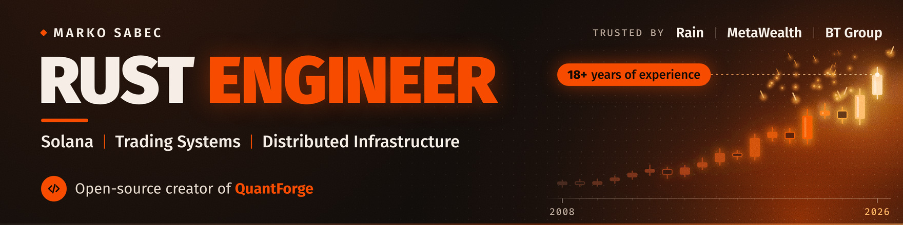
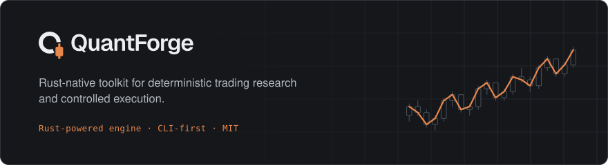
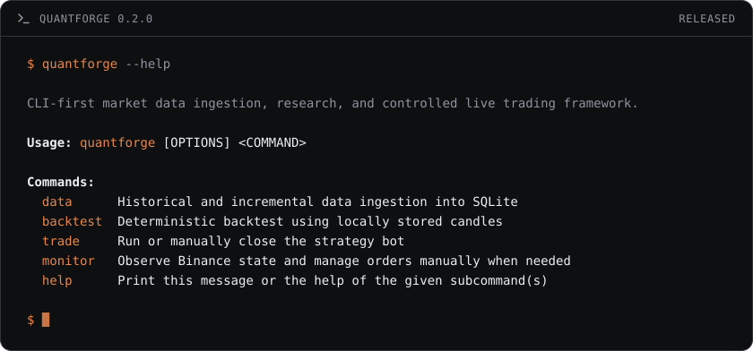
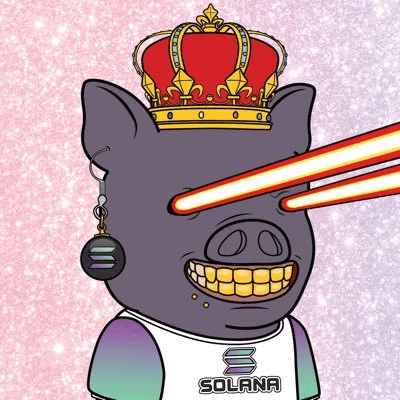
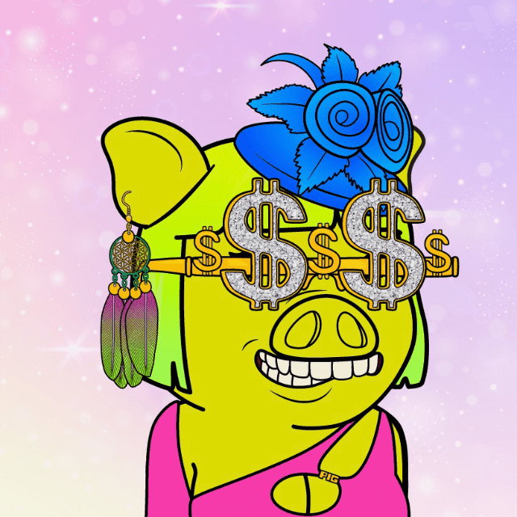
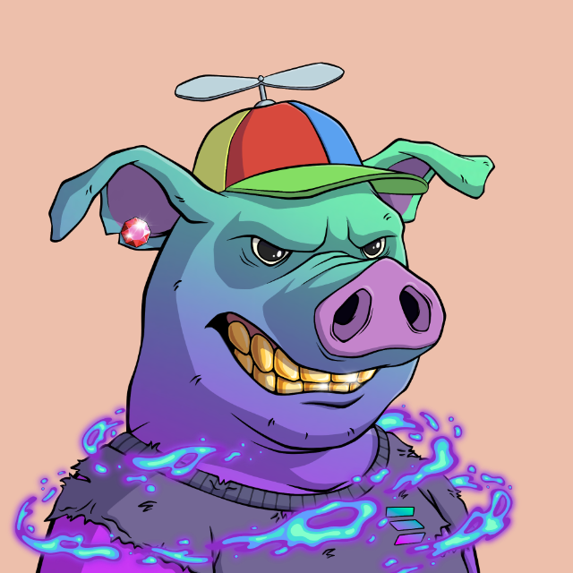
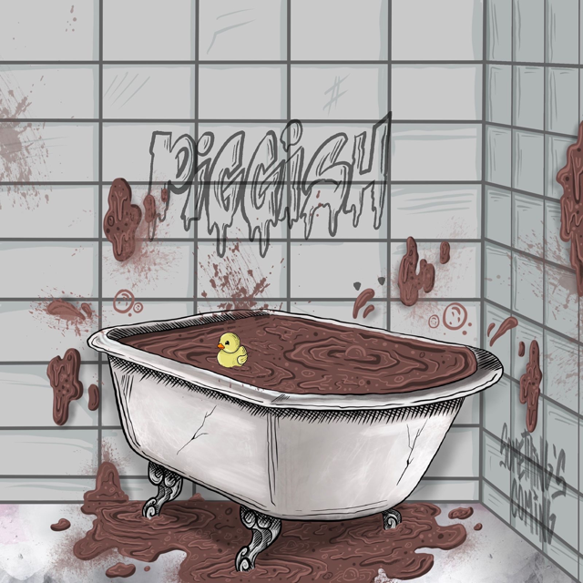

<h2>Hi, I'm Marko 👋</h2>

  
  
  

Rust engineer, 18+ years building backends — trading systems, Solana infrastructure and distributed services for **Rain**, **MetaWealth** and **BT Group**.

These days I build two things: **QuantForge**, a trading framework where a backtest gives you the same answer every single time you run it, and **Piggy Gang**, a Solana NFT ecosystem with a Rust indexer underneath. I like determinism, clean boundaries between the parts, and the shortest dependency list that does the job.

**A trading framework for Rust. Pull in market data, backtest a strategy, run it live — all from the terminal.**

  
  
  

  
  
  
  
  

Dry-run by default · Deterministic backtests · Decimal money, never `f64` · No `unsafe`, no `unwrap()`

**[quantforge.rs](https://quantforge.rs)** · **[github.com/quantforge-rs](https://github.com/quantforge-rs)** · `cargo install quantforge`

Engineering software. Not investment advice, and no promise of profit.

<h2>🐷 Piggy Gang</h2>

**Apps and art for the whole gang — start anywhere.**

  
  
  
  

  
  
  
  

Four NFT collections on Solana, a Rust [indexer](https://github.com/piggygang/indexer), an on-chain [raffle program](https://github.com/piggygang/raffles-program) and six web apps — all built in the open.

✅ **Live** — [Explorer](https://explorer.piggygang.net) · [DressMe](https://dressme.piggygang.net) · [Indexer API](https://api.indexer.piggygang.net/v1/collections) 
🧪 **Preview** — [Raffles](https://raffles.piggygang.net) · [alpha.art](https://alpha.art)

**[piggygang.net](https://piggygang.net)** · **[github.com/piggygang](https://github.com/piggygang)**

Piggy SOL Gang · Piggy Girl Gang · Piggy Gang · Pig Mud ·  $PIGGY

<h2 align="center">About me 🦀</h2>

<b>🌍 Slovenia — CET/CEST, <code>Europe/Ljubljana</code></b>

🔸 **Right now:** [QuantForge](https://github.com/quantforge-rs) — Binance and SQLite today, Bybit and Postgres next — and the [Piggy Gang](https://github.com/piggygang) stack. 
🔸 **Good at:** backends that behave predictably — exact arithmetic, no look-ahead, and safety you can't switch off by accident. 
🔸 **Solana:** Token Metadata and Core, Helius backfill and live streaming, wallets that sign in the browser and nowhere else. 
🔸 **Infrastructure:** small hardened containers, one Dockerfile for a whole workspace, config kept as code. 
🔸 **Ask me about:** why a backtest should be a pure function, and why changing an API contract is always two commits.

<h2 align="center">⚒️ Languages · Frameworks · Tools ⚒️</h2>

  
   
  

<picture>
  <source media="(prefers-color-scheme: dark)"  srcset="https://raw.githubusercontent.com/formaldehid/formaldehid/output/github-snake-dark.svg" />
  <source media="(prefers-color-scheme: light)" srcset="https://raw.githubusercontent.com/formaldehid/formaldehid/output/github-snake.svg" />
  
</picture>

  
  

More repos are being opened up as they stabilize.

